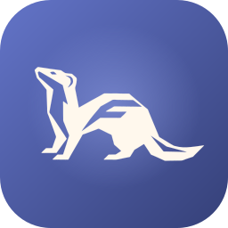

<p align="center">
  
</p>

<h1 align="center">Mustel</h1>

<p align="center"><strong>A little ferret for your Flutter hot reloads.</strong></p>

<p align="center">
  <a href="https://github.com/Mooyeee/mustel/releases/latest"></a>
  <a href="https://github.com/Mooyeee/mustel/actions/workflows/tests.yml"></a>
  <a href="https://github.com/Mooyeee/mustel/stargazers"></a>
  <a href="https://github.com/Mooyeee/mustel/releases"></a>
  <a href="https://github.com/Mooyeee/mustel/commits/main"></a>
</p>

<p align="center">
  
  
  
  
  
  
  <a href="./LICENSE"></a>
  
</p>

Mustel is a macOS menu-bar app that puts hot reload and hot restart within reach while you work. It can discover supported Flutter runs, control Flutter sessions already running in VS Code, IntelliJ IDEA, or Android Studio, or launch a Flutter project itself. Its goal is to make the quick feedback loop easy to reach without switching back to a terminal or interrupting your current workflow.

The name comes from *Mustela*, the genus that includes ferrets and weasels: curious little creatures that like to get into things. In the same spirit, Mustel gets its paws on Flutter's reload controls.

> **In a hurry?** Install the app with `./scripts/install-app.sh`, then install the VS Code bridge or the IntelliJ bridge from the latest [GitHub release](https://github.com/Mooyeee/mustel/releases/latest). Both bridges can be installed manually from the IDE without building anything.

## Contents

- [Quick start](#quick-start)
- [What it does](#what-it-does)
- [Requirements](#requirements)
- [Install the macOS app](#install-the-macos-app)
- [Install the VS Code bridge](#install-the-vs-code-bridge)
- [Install the IntelliJ bridge](#install-the-intellij-bridge)
- [Using Mustel](#using-mustel)
- [Privacy and local bridge](#privacy-and-local-bridge)
- [Troubleshooting](#troubleshooting)
- [Development](#development)
- [Known limitations](#known-limitations)
- [License](#license)

## Quick start

1. **Install the app.** Build and install Mustel from source with [`./scripts/install-app.sh`](#install-the-macos-app).
2. **Install an IDE bridge.** Download the `.vsix` or IntelliJ plugin `.zip` from the [latest release](https://github.com/Mooyeee/mustel/releases/latest) and install it from your IDE. You do not need to build the bridges yourself.
3. **Start a Flutter run.** Use `flutter run` in a terminal or start a debug session in your IDE. The session appears in Mustel's menu-bar popover, ready for hot reload and hot restart.

Mustel can update itself and tell you when a newer bridge is available from **Settings → UPDATES**.

## What it does

- **Lives in the macOS menu bar.** Click the ferret to open Mustel; right-click it to quit. The ferret runs while Mustel scans for Flutter runs, or permanently if you enable **Always animate the logo** in Settings.
- **Can stay still.** Turn off logo animations in Settings if you prefer a static menu-bar icon.
- **Checks GitHub for updates.** Open Settings to see the installed version, check for a newer GitHub release, and install it directly from the app.
- **Discovers existing mobile Flutter runs.** Mustel scans for supported Android and iOS runs and attaches to them automatically.
- **Controls IDE debug sessions.** With the companion bridge installed, use hot reload and hot restart on active Flutter runs in VS Code, IntelliJ IDEA, or Android Studio. Mustel sends the request to the IDE; it does not start a competing `flutter attach` for those sessions.
- **Launches Flutter projects.** Choose a project and device in Mustel to start and control a new `flutter run --machine` session, including macOS desktop and web targets.
- **Supports desktop/web VM Service discovery when enabled.** Start a run with `--vmservice-out-file` and Mustel can read the VM Service URL from the file.
- **Can launch at login.** Enable **Launch at login** in Settings after installing the app.

## Requirements

- macOS 14 or later
- Xcode Command Line Tools and Swift 5.9 or later
- Flutter installed. Mustel checks the app's `PATH`, common SDK locations, and a project's FVM SDK; otherwise enter the executable path in **Settings → Flutter executable**
- `librsvg` (`rsvg-convert`) to generate the app icons
- For VS Code integration: VS Code 1.85 or later and the [Dart extension](https://marketplace.visualstudio.com/items?itemName=Dart-Code.dart-code)
- For IntelliJ integration: IntelliJ IDEA or Android Studio 2023.1 or later, with the Flutter and Dart plugins installed

## Install the macOS app

### From a release

1. Open the [latest Mustel release](https://github.com/Mooyeee/mustel/releases/latest).
2. Download and unzip `Mustel.zip`.
3. Move `Mustel.app` to `~/Applications` (or `/Applications`).
4. Open Mustel from Applications or Spotlight.

The app is ad-hoc signed and **not notarized**, so macOS may ask you to allow it under **System Settings → Privacy & Security**.

### From source

Clone the repository, then from its directory run:

```sh
brew install librsvg
./scripts/install-app.sh
open "$HOME/Applications/Mustel.app"
```

The installer generates the icons from [`Resources/ferret.svg`](./Resources/ferret.svg), builds the release app, installs it in `~/Applications`, and verifies its code signature. If `flutter` is available in the installer's `PATH`, it saves that executable path for the app so it can also find Flutter when opened from Finder. Run the installer again after pulling updates.

The app is locally ad-hoc signed and **not notarized**. This setup is intended for building from source on your own Mac, not distributing a ready-to-run app to other people. Launch at login uses Apple's `SMAppService` API to start the regular app in your user session; Mustel is not a privileged daemon. If macOS requests approval, allow it under **System Settings → General → Login Items**.

## Install the VS Code bridge

The VS Code bridge is a small extension, written in TypeScript, that lets Mustel trigger hot reload and hot restart on Dart/Flutter debug sessions running in VS Code.

### From a release (recommended)

1. Open the [latest Mustel release](https://github.com/Mooyeee/mustel/releases/latest).
2. Download the VS Code asset named `mustel-vscode-<version>.vsix` (for example `mustel-vscode-0.1.1.vsix`).
3. In VS Code open **Extensions** (`⇧⌘X`), click the **…** menu at the top of the Extensions view, and choose **Install from VSIX…**.
4. Select the downloaded file.
5. Reload VS Code with **Developer: Reload Window** from the Command Palette.

From a terminal you can also install it with:

```sh
code --install-extension /path/to/mustel-vscode-<version>.vsix
```

Verify it in **Extensions → Installed** as **Mustel Bridge**. The extension requires the [Dart extension](https://marketplace.visualstudio.com/items?itemName=Dart-Code.dart-code) to be installed and enabled.

### From source

```sh
cd vscode-extension
npm install
npm run compile
npx @vscode/vsce package
```

Use a current Node.js release for VSIX packaging. The generated `mustel-vscode-<version>.vsix` is in `vscode-extension/`.

Start a Dart/Flutter debug session after installing the bridge. It appears in Mustel's **IDE sessions** section with its own hot reload and hot restart controls.

## Install the IntelliJ bridge

The IntelliJ bridge is a separate Java plugin for IntelliJ IDEA and Android Studio, built with Gradle.

### From a release (recommended)

1. Open the [latest Mustel release](https://github.com/Mooyeee/mustel/releases/latest).
2. Download the asset named `mustel-intellij-<version>.zip` (for example `mustel-intellij-0.1.1.zip`).
3. In IntelliJ IDEA or Android Studio open **Settings** (`⌘,`) → **Plugins**.
4. Click the gear icon next to **Installed** and choose **Install Plugin from Disk…**.
5. Select the downloaded `.zip` and confirm.
6. Restart the IDE when prompted.

Verify it under **Settings → Plugins → Installed** as **Mustel Bridge**. The plugin requires the Flutter and Dart plugins, and targets IntelliJ Platform 2023.1 or later.

### From source

```sh
cd intellij-plugin
./gradlew buildPlugin
```

Install the generated `build/distributions/mustel-intellij-<version>.zip` with **Settings → Plugins → Install Plugin from Disk…**, then restart the IDE. Start a Flutter run configuration; it appears in Mustel's **IDE sessions** section with hot reload and hot restart controls.

To build against an already installed IDE instead of downloading a platform, pass the local paths explicitly:

```sh
JAVA_HOME="/Applications/Android Studio.app/Contents/jbr/Contents/Home" ./gradlew buildPlugin \
  -Pmustel.localIde="/Applications/Android Studio.app/Contents" \
  -Pmustel.flutterPlugin="$HOME/Library/Application Support/Google/AndroidStudio2025.3.1/plugins/flutter-intellij" \
  -Pmustel.dartPlugin="$HOME/Library/Application Support/Google/AndroidStudio2025.3.1/plugins/Dart" \
  -Pmustel.lsp4ijPlugin="$HOME/Library/Application Support/Google/AndroidStudio2025.3.1/plugins/lsp4ij"
```

## Using Mustel

### Control an existing mobile run

Start a Flutter app on a supported Android or iOS device as usual. Mustel periodically scans for eligible runs; use the refresh button to scan immediately. Select its reload or restart control from the menu-bar popover.

If more than one supported device is connected, specify the device when starting the run so Mustel can match it unambiguously:

```sh
flutter run -d <device-id>
```

### Control an existing IDE session

Install and enable the VS Code bridge or the IntelliJ bridge, then start or keep a Flutter run active in the IDE. Mustel lists sessions from each open VS Code window, IntelliJ IDEA window, or Android Studio window and sends the selected action to the IDE.

### Launch a project from Mustel

Click **+**, choose a Flutter project folder and a connected device, and select **Run**. Mustel starts and manages the `flutter run --machine` process. The launched session has its own reload, restart, and stop controls.

### Discover an existing desktop or web run

Flutter does not provide a reliable place for Mustel to discover the authenticated VM Service URL for an already-running desktop or web app by default. To opt in, start the run with an output file:

```sh
flutter run -d macos --vmservice-out-file=/tmp/my-app-vmservice.json
```

Mustel reads the URL from that file and attaches to it. The file must contain the URL for the current run; stale URLs are ignored. Alternatively, launch the desktop or web project from Mustel.

### Update Mustel

Open Settings and expand the panel. Mustel shows the installed version and checks the latest GitHub release the first time you open Settings. Use **Update** when a newer version is available; Mustel downloads `Mustel.zip`, verifies the bundle identifier and code signature, replaces the app, and relaunches it. Update progress and errors appear in the same section, and installation details are written to `~/Library/Logs/Mustel/update.log`.

The same section also checks the installed VS Code and IntelliJ bridge versions. When a release includes newer bridge assets, Mustel shows a download link; install the `.vsix` or plugin `.zip` through your IDE as usual. Updates to the app itself require running the installed `.app` bundle. Ad-hoc signed builds are supported, but macOS may still require you to allow the app in **System Settings → Privacy & Security** after an update.

## Privacy and local bridge

The VS Code extension and IntelliJ plugin are local to your Mac. They communicate with the app through per-user files and Unix domain sockets; neither bridge exposes a network listener or requires a cloud service. The bridge directory is restricted to the current user, socket files are owner-only, and Mustel validates the socket paths it reads. The bridges accept requests only for active Flutter runs owned by the IDE process and support only hot reload and hot restart commands.

Mustel contacts the public GitHub API (`api.github.com`) when it checks for updates. No project or session data is sent. Mustel invokes the Flutter executable you configure. Flutter itself may perform its normal network operations, for example when resolving packages or running a project; those are not relayed through Mustel's IDE bridge.

## Troubleshooting

- **Mustel cannot find Flutter:** Mustel searches its available `PATH`, common Flutter SDK locations, and the project's `.fvm/flutter_sdk`. Apps launched from Finder may not inherit the same shell `PATH` as Terminal. If automatic lookup fails, open **Settings → Flutter executable** and enter the absolute path to the `flutter` executable (for example, `/Users/you/development/flutter/bin/flutter`).
- **An existing run is missing:** refresh discovery. For mobile runs with multiple connected devices, restart with `flutter run -d <device-id>`. Desktop/web runs need `--vmservice-out-file` to be discovered automatically.
- **Attach reports that `.dart_tool/package_graph.json` is missing:** run `flutter pub get` in the project directory, then reconnect.
- **VS Code sessions do not appear:** confirm the Dart extension and Mustel Bridge are enabled, start a Dart/Flutter debug session, and reload VS Code after installing the VSIX.
- **IntelliJ sessions do not appear:** confirm the Flutter and Dart plugins are enabled and the Mustel Bridge plugin is installed, then start a Flutter run configuration. Restart the IDE after installing the plugin ZIP.
- **An IDE bridge reports an error after an update:** reinstall the matching `.vsix` or plugin `.zip` from the latest release and restart the IDE. Mustel can detect and link to bridge updates, but installing them is always done from VS Code or IntelliJ/Android Studio.
- **Launch at login is unavailable:** install and open `~/Applications/Mustel.app`; it is not available when running with `swift run`.

## Development

Build and run the menu-bar app from source:

```sh
swift build --configuration debug --product mustel
swift run mustel
```

Run the unit tests:

```sh
swift test
```

Build the release app and install it with the same script used above:

```sh
./scripts/install-app.sh
```

Package the installed app and both IDE bridges for a GitHub release:

```sh
./scripts/package-release.sh
# publish the release with the GitHub CLI:
./scripts/package-release.sh --publish
# package without replacing the app currently installed in ~/Applications:
./scripts/package-release.sh --no-install --publish
```

The script writes these assets to `.build/releases/`:

- `Mustel.zip`
- `mustel-vscode-<version>.vsix`
- `mustel-intellij-<version>.zip`

Upload them to a GitHub release whose tag is the app version, for example `v0.1.7`. The in-app updater reads the latest release from `Mooyeee/mustel` and requires `Mustel.zip` (or another `.zip` containing `Mustel.app`). It also compares the installed VS Code and IntelliJ bridge versions with the `.vsix` and IntelliJ `.zip` assets and shows a download link in Settings when a newer bridge is available. Bump `CFBundleShortVersionString` and `CFBundleVersion` in [`Resources/Info.plist`](./Resources/Info.plist), and the versions in `vscode-extension/package.json` and `intellij-plugin/build.gradle.kts`, before packaging.

Compile the VS Code extension:

```sh
cd vscode-extension
npm install
npm run compile
```

For extension development, open `vscode-extension/` in VS Code, press **F5** to launch an Extension Development Host, then start a Flutter debug session there while Mustel is running.

Compile the IntelliJ plugin:

```sh
cd intellij-plugin
./gradlew buildPlugin
```

For plugin development, run `./gradlew runIde` to launch a sandboxed IDE with the bridge loaded. See [`intellij-plugin/README.md`](./intellij-plugin/README.md) for local-platform build options.

## Known limitations

- Automatic discovery of existing non-IDE-managed runs supports Android and iOS. Existing macOS desktop and web runs need `--vmservice-out-file`; starting a new desktop or web run from Mustel is also supported.
- When a mobile run does not specify a device ID, automatic matching is possible only when exactly one supported device is connected.
- Mustel skips IDE-managed Flutter runs during process discovery to avoid competing with the IDE's Flutter tool. Use the VS Code or IntelliJ bridge for IDE-managed sessions.
- Attaching to an external Flutter run can involve a second Flutter tool client and may conflict with the original run. For an owned session, launch it from Mustel; for an IDE session, use the bridge.
- Flutter machine-protocol behavior can vary between Flutter SDK versions.

## License

Mustel is licensed under the [MIT License](./LICENSE).
